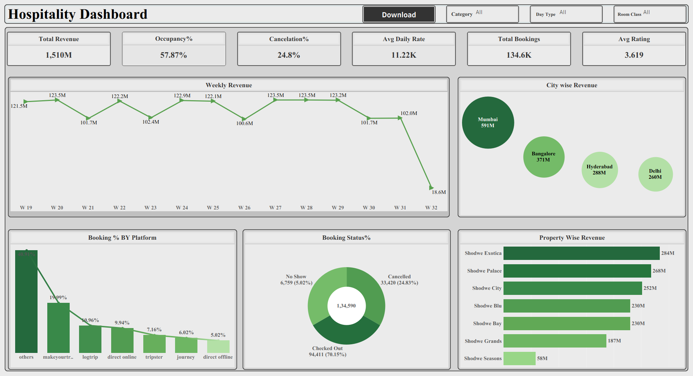

# 🏨 Hospitality Analytics Dashboard

## 📌 Project Overview
An end-to-end business intelligence project designed to analyze hospitality business performance, revenue metrics, occupancy rates, and booking trends using SQL and interactive dashboards.

---

## 🛠 Tech Stack & Tools
* **Database & Querying:** SQL (Data cleaning, handling nulls/granularity, aggregations, and CTEs)
* **Visualization:** Power BI & Tableau
* **Design Theme:** Custom grid-based dark mode canvas layout

---

## 📊 Key Business Insights & Metrics
* **Financial Performance:** Tracked total revenue generated, average daily rate (ADR), and revenue per available room (RevPAR).
* **Occupancy & Bookings:** Evaluated occupancy rate percentages across weekend vs. weekday trends.
* **Channel Analysis:** Identified key booking channels driving maximum revenue and cancellation percentages.

---

## 🚀 Dashboard Previews

### Power BI Dashboard

### Tableau Dashboard

---

## 📂 Repository Structure
* `SQL_Scripts/` : Contains backend SQL logic and analytical queries.
* `Dashboard_Files/` : Contains source dashboard files.
*
